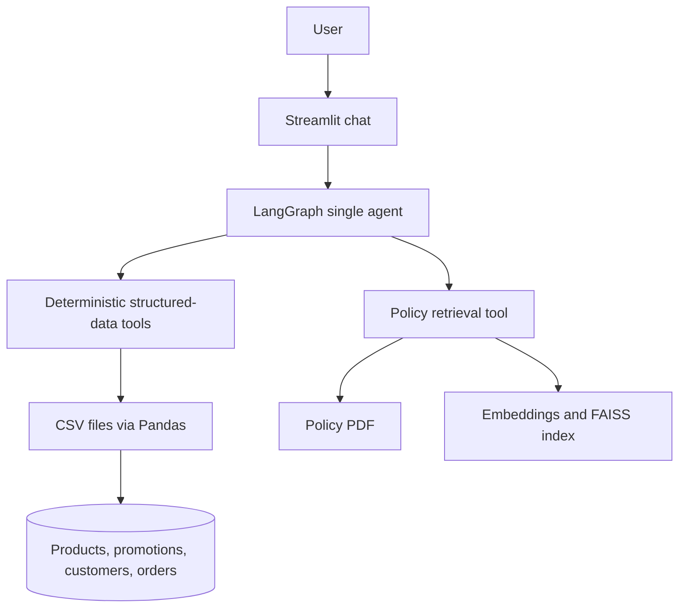

# Artefact AI Engineer Technical Case

## Project overview

Empório da Música needs a customer-service assistant that can answer questions about its instrument catalog, current prices and stock, promotions, orders, and store policies. This MVP connects a Streamlit chat interface to a single LangGraph agent and the supplied synthetic CSV and policy PDF sources.

The model interprets requests and writes customer-facing responses. Python tools provide current structured facts, calculate prices and promotions, gate order details behind identity verification, and retrieve policy evidence. The model does not receive the full customer or order tables.

## Architecture



## Key design decisions

1. **Product and order data use deterministic tools.** Prices, stock, promotions, and historical orders are structured facts with exact values and filtering rules. A model search over prose would make constraints and provenance harder to enforce.
2. **The policy manual uses retrieval.** Policy answers depend on a short document rather than changing row-level records. The retriever returns source text and page metadata for the agent to summarize.
3. **One agent is sufficient.** A single tool-calling graph keeps orchestration, conversation context, and failure behavior easy to inspect for this MVP.
4. **Pandas is sufficient for the supplied dataset.** The CSV files are small, local, and easy to validate. A database would add setup and operational work without improving this case.
5. **Currency rules use Python and `Decimal`.** Promotion and PIX calculations are deterministic and use decimal arithmetic with cent rounding.
6. **Order verification is enforced below the model.** The order tool checks the supplied email or phone against the order owner before returning allowed order fields. The model cannot override that check.
7. **Tests inject fake models and embedders.** This keeps routine tests deterministic, offline, and independent of provider credentials while exercising the graph and retrieval interfaces.

## Repository structure

- `app.py` — Streamlit entry point.
- `data/` — six supplied CSV files and the store policy PDF.
- `src/agent/` — system prompt, state, tools, and LangGraph orchestration.
- `src/tools/` — deterministic product, promotion, order, and policy tool adapters.
- `src/rag/` — policy PDF extraction, embeddings, and FAISS retrieval.
- `tests/` — offline data, business-rule, agent, UI-helper, and eval-runner tests.
- `evals/` — live behavioral cases, runner, and qualification record.
- `examples/` — customer-facing example conversations.
- `docs/MVP_SPEC.md` — implementation scope and architecture specification.

## Setup

Use Python 3.11 or 3.12.

### Ubuntu, Linux, and macOS

```bash
python -m venv .venv
source .venv/bin/activate
pip install -r requirements.txt
cp .env.example .env
```

### Windows PowerShell

```powershell
python -m venv .venv
.\.venv\Scripts\Activate.ps1
pip install -r requirements.txt
Copy-Item .env.example .env
```

Set these variables in `.env`:

```dotenv
OPENAI_API_KEY=your-provider-key
OPENAI_MODEL=your-chat-model
OPENAI_EMBEDDING_MODEL=your-embedding-model
OPENAI_BASE_URL=
```

`OPENAI_API_KEY` is passed to the native Gemini chat integration. `OPENAI_BASE_URL` is optional and applies to the OpenAI-compatible Gemini embedding endpoint; chat completion uses the configured Gemini model directly. Keep `.env` local and never commit it.

## Running

```bash
streamlit run app.py
```

The chat keeps LangGraph messages for the current Streamlit session. “New conversation” clears that session’s conversation.

## Tests

Run the offline suite with:

```bash
pytest -q
```

These tests use local model and embedder doubles. They do not make provider calls or require API credentials.

## Behavioral evaluations

The live evaluation suite checks tool selection, structured tool results, response grounding, policy evidence, multi-turn context, and order privacy. It uses the configured chat model and real policy embeddings, paces chat calls, and applies bounded exponential backoff to transient provider failures.

```bash
python -m evals.run_evals --live
```

Live evaluations require `OPENAI_API_KEY`, `OPENAI_MODEL`, `OPENAI_EMBEDDING_MODEL`, network access, and provider quota. They are separate from `pytest -q` and may incur provider usage. The runner writes safe summaries to [`evals/live_results.md`](evals/live_results.md); it omits tool arguments, credentials, and raw framework messages.

## Example conversations

See [`examples/conversations.md`](examples/conversations.md). Live examples are recorded only after successful provider-backed runs; no simulated conversation is presented as a live result.

## Business invariants

- A product is sellable only when its status is `active` and stock is greater than zero.
- Current price, stock, promotion, and order facts come from deterministic tools.
- An active product promotion and the 5% PIX discount do not stack.
- Historical order totals come from the order dataset, not current catalog prices.
- Order details require an email or phone match with the customer associated with that order.
- Tracking information is returned only when the order record contains it.

## Privacy and safety

Order verification is a lightweight MVP privacy gate, not production authentication. The order tool returns only fields for the requested verified order and does not return the customer record, verification proof, or order notes. The full customer and order datasets are not placed in the model prompt; only the result of a specific tool call is passed to the agent. Retrieved policy text is treated as untrusted evidence and cannot override system instructions.

## Assumptions

- The supplied data is a synthetic snapshot; product price and stock answers reflect that snapshot.
- The policy manual is the source of truth for store policies and is written in Portuguese.
- “Acoustic guitar” product discovery corresponds to the catalog’s `Violões` category.
- A matching email or phone is enough for the case’s MVP verification flow; this is not an account-authentication design.
- Conversation context lasts for the current Streamlit session only.

## Phase 6 status

`PHASE_6_COMPLETE_READY_FOR_SUBMISSION_ARTIFACT`

The native Gemini chat model completed a real LangGraph tool cycle through `ToolNode` and a follow-up model response. The live suite passed all 12 required scenarios, an additional PIX follow-up, and all four robustness probes (17/17 records, no blocked calls). A live Streamlit smoke verified app startup, input, a product price response, the PIX follow-up, hidden tool messages, and the new-conversation reset. The sanitized scenario-by-scenario record is in [`evals/live_results.md`](evals/live_results.md), and [`examples/conversations.md`](examples/conversations.md) contains five provider-backed conversations using only the synthetic case data.

The offline suite is run with `pytest -q`. Live qualification can be repeated with `python -m evals.run_evals --live`; it uses provider calls and may consume quota. The report excludes credentials, private verification values, chain-of-thought, and raw framework messages.

## Limitations

- This is a local Streamlit application with session-only memory.
- There is no production authentication, external database, or persistent user history.
- Policy answers use one supplied PDF and depend on retrieval quality and provider embeddings.
- There is no production monitoring or deployment configuration.
- Tool-calling reliability and response wording depend on the configured model provider.

## Future improvements

- Add authentication and a server-side customer identity flow before exposing real customer data.
- Add a source-of-truth service for catalog and order data if the application moves beyond the supplied snapshot.
- Add monitored provider-backed evaluation runs and policy retrieval quality checks.
- Add accessibility and usability review with store staff before broader use.
